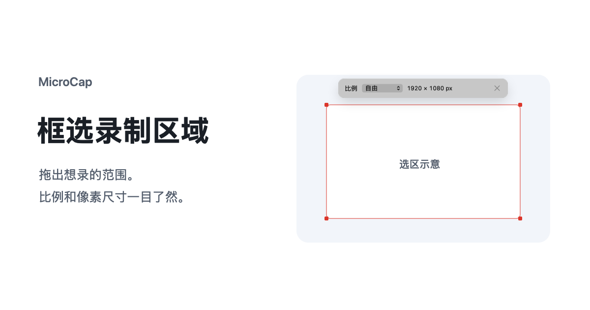

# MicroCap

**轻量的 macOS 菜单栏录屏工具。录全屏或指定区域，按需加入系统声音、麦克风和摄像头画中画。视频直接保存在 Mac 上。**

适用于 **Apple 芯片 Mac（M1 及更新机型）**，系统要求 **macOS 15.0 或更新版本**。

## 为什么用 MicroCap

- **小巧原生。** 录制和编码使用 macOS 自带的框架，应用常驻菜单栏。
- **按场景选画质。** 快速选择偏向清晰度、文件大小或分享兼容性的录制预设，也可以保存自己的预设。
- **录制控制就在菜单栏。** 单击暂停或继续，双击停止并保存。支持定时停录和可自定义的全局快捷键。
- **声音和画中画按需开启。** 系统音与麦克风可独立录制，摄像头小窗可以移动、缩放。
- **录制文件保存在本地。** 可自行选择保存文件夹，也可以在 Finder 里快速找到最近一次录制。

## 发布计划

MicroCap 计划在 Mac App Store 上架，敬请期待。

## 录制第一段视频

1. **打开录制面板。** 启动 MicroCap 后，单击菜单栏里的应用图标。首次录制时按系统提示授权屏幕录制。使用麦克风或画中画时，再按提示授予相应权限。
2. **选录制范围。** 选「整个屏幕」即可使用鼠标所在的显示器。选「自选区域」后，在屏幕上拖出一个矩形。松开鼠标后，可拖动控制栏移动范围，也可以拖动边缘调整大小。
3. **选录制预设。** 第一次可以选「优化均衡」。要录电脑里的播放声就开启「系统音」，要录自己的声音就开启「麦克风」。需要把自己录进画面时，打开「画中画」。
4. **点击「开始录制」。** 如果设置了倒计时，等倒计时结束后就会开录。录制时可以单击菜单栏图标暂停，再单击继续。
5. **停止并查看。** 双击菜单栏图标，或右键选择「停止并保存」。保存完成后，打开面板，点「显示上次录制」即可在 Finder 中定位文件。

## 常用按钮

| 按钮或操作 | 功能 |
| --- | --- |
| 开始录制右侧的秒表 | 设置录制时长，到时自动停止并保存。可选 5、10、30、60 分钟，或在「自定义」输入分钟数后按回车。「不限时」用于手动停录。暂停及开始前的倒计时不计入录制时长。 |
| 分辨率、帧率 | 控制输出画面的尺寸上限和流畅度。 |
| 画中画 | 打开摄像头小窗。拖动小窗可移动位置，在小窗上滚动可缩放。录制中可通过菜单栏右键菜单开关。 |
| 区域控制栏的比例与尺寸 | 调整自选区域比例，查看输出像素尺寸。录制前点叉号可取消所选区域。 |
| 菜单栏图标右键 | 打开设置或退出应用。录制中也可暂停、停止并保存，或切换系统音、麦克风和画中画。 |

## 如何选录制预设

| 预设 | 适合的场景 |
| --- | --- |
| 优化均衡 | 日常录屏、教程和演示。 |
| 体积优先 | 需要节省存储空间或方便发送的录屏。 |
| 画质优先 | 更在意文字细节、渐变和色彩的画面。 |
| 兼容分享 | 录完要分享给使用不同设备或播放器的人。 |
| 自定义 | 需要自行控制输出时使用。常用配置可以在「设置 → 录制 → 我的预设」中保存。 |

## 常用设置

- **设置 → 录制** 可以调整系统音与麦克风的录入音量、选择输入设备、设置画中画比例和开始前的倒计时。如果需要单独编辑人声，可同时开启两路音源并勾选「麦克风单独保存」。
- **设置 → 存储** 可以选择保存位置、恢复默认文件夹或切换界面语言。默认保存到「影片 → MicroCap」。
- **设置 → 快捷键** 可以设置开始、停止、暂停、显示面板，以及录制中切换音源或画中画的快捷键。

录制时出现的屏幕采集图标是 macOS 的隐私提示。如果录制的声音有回声，可以试试戴耳机，或先关闭麦克风只录系统音，确认是否是麦克风收进了扬声器的声音。
